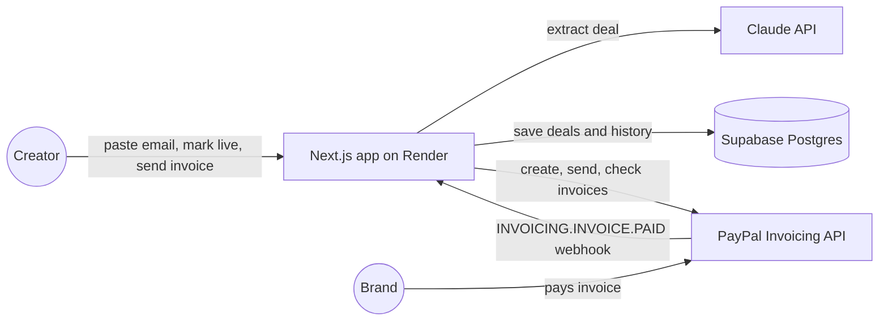

# Dealflow

**Get paid by brands without chasing them.** Dealflow is an AI payment assistant for Indian creators who do sponsored posts for foreign brands. Paste the brand's email, paste the link to your live post, and Dealflow sends the brand a PayPal invoice with the post attached as proof, then marks the deal paid the moment the brand pays.

Built for the **PayPal AI Hackathon** (Business Solutions track).

- **Live demo:** [https://YOUR-APP.onrender.com](https://dealflow-bdou.onrender.com) (login details are in the Devpost submission)
- **Demo video:** https://youtu.be/YOUR-VIDEO


---

## The problem

Indian creators who work with US and European brands often wait weeks to get paid. After the post goes live, they still have to write an invoice, prove the post is up, wait for approval, and follow up again and again. Deal terms, invoices and payments are scattered across email threads and PayPal, so it is hard to answer simple questions: *How much am I owed? Who is late? What is coming in this month?*

Most of these creators have no manager or accountant, so this admin work comes out of the time they would spend creating.

## What Dealflow does

1. **Paste the brand's email.** Claude reads it and pulls out the brand, deliverables, price, payment terms and deadline. If the email has no price, Dealflow says so instead of guessing.
2. **Mark the post live.** Paste the link to the published video or reel. It becomes the proof of delivery.
3. **Send the invoice.** One click creates and sends a PayPal invoice to the brand, with the live post linked in the invoice note.
4. **Get paid.** When the brand pays, PayPal notifies Dealflow by webhook and the deal turns **Paid** automatically. A **Check payment** button asks PayPal directly, as a backup.
5. **See everything in one place.** The dashboard shows what you are owed, what is overdue, what is paid and what still needs an invoice, plus a "needs attention" list.

Every action is recorded in a history log that shows who did it: the **AI**, the **creator**, **PayPal** or the **system**.

| Paste email | Deal page | PayPal invoice |
|---|---|---|
|  |  |  |

## How PayPal is used

| PayPal API | What Dealflow uses it for |
|---|---|
| OAuth 2.0 (`/v1/oauth2/token`) | Server-side access token, cached and refreshed before it expires |
| Invoicing v2: create (`/v2/invoicing/invoices`) | Builds the invoice: brand as recipient, amount, payment terms, proof link in the note |
| Invoicing v2: send (`/v2/invoicing/invoices/{id}/send`) | Sends the invoice to the brand |
| Invoicing v2: get (`/v2/invoicing/invoices/{id}`) | Reads the live status and payment link, and powers **Check payment** |
| Webhooks (`INVOICING.INVOICE.PAID`) | Marks deals paid automatically |
| Verify webhook signature (`/v1/notifications/verify-webhook-signature`) | Rejects any webhook that did not come from PayPal |

PayPal in India only supports cross-border payments, which is exactly this use case: a foreign brand paying an Indian creator.

## How the AI is used, safely

- **Claude Haiku 5.5** turns a messy brand email into a structured deal (JSON).
- The reply is **validated with a zod schema** before anything uses it: positive amount, USD only, a payment term PayPal supports, a valid brand email.
- If the reply is invalid, Dealflow **retries once** and tells the model exactly which field was wrong.
- If the price or brand email is missing, the model must say so. **It never guesses money.**
- The brand email is passed to the model as quoted data, not instructions, as a basic guard against prompt injection.
- The AI only drafts. **Code decides** what happens to money: status rules, invoice building and payment checks are all plain, tested TypeScript.

## Architecture



The code is layered so the business rules never touch the network:

```
src/
  domain/    Pure business rules: deal states, money in cents, reminder policy, needs-attention, totals
  ai/        Claude client, deal schema (zod), email-to-deal extraction with retry
  paypal/    Access token, invoice payload, create/send/get invoice, webhook verification
  store/     Supabase client and deal store (database rows <-> app types)
  usecases/  One function per user action: create deal, mark live, send invoice, check payment, handle webhook
  ui/        Display helpers and the dashboard view model
  app/       Next.js pages, server actions and the webhook route
  lib/       Wiring (services.ts) and the password check
supabase/
  schema.sql Database tables, constraints and row level security
```

Every outside service (PayPal, Claude, Supabase, the clock) is passed into the code that uses it, so all of the logic is unit tested with fakes.

## Reliability and security

- **Money is stored as integer cents**, never floating point.
- **A state machine** controls every deal: draft → live → invoiced → paid. You cannot invoice before the post is live or pay twice.
- **Webhooks are idempotent.** Each PayPal event ID is stored with a unique key, so a repeated event can never mark a payment twice. Events that failed half-way are retried safely.
- **Optimistic concurrency.** A deal only changes status if it is still in the status it was read in, so a double click cannot send two invoices.
- **Webhook signatures are verified** with PayPal before any event is trusted.
- **Database constraints back up the code**: positive amounts, USD only, valid statuses, unique PayPal invoice IDs.
- **Row level security** blocks public access to the database. Only the server, with the secret key, can read or write.
- **Secrets stay on the server.** `server-only` makes the build fail if server code is ever imported into the browser.
- **The app is password-protected.** Only the PayPal webhook is public, and it is protected by the signature check.
- **An audit log** records every action and who took it.

## Tests

Built test-first: each module started with a failing test.

- **149 unit tests** across domain rules, AI extraction, PayPal client, use cases and UI helpers
- No test calls a real API: PayPal, Claude and the database are replaced with fakes
- **Every deploy runs the tests first.** If any test fails, the new version does not go live.

```bash
npm test
```

## Tech stack

Next.js 16 (App Router, server actions) · TypeScript · Claude API (Haiku 5.5) · PayPal REST APIs (sandbox) · Supabase (Postgres) · zod · Vitest · Render

## Run it locally

**You need:** Node.js 20.9 or newer, a PayPal developer account, a Supabase project and a Claude API key.

1. **Clone and install**

   ```bash
   git clone https://github.com/YOUR-USERNAME/dealflow.git
   cd dealflow
   npm install
   ```

2. **PayPal sandbox**
   - On developer.paypal.com, create a **Business** sandbox account (the creator) and a **Personal** sandbox account (the brand).
   - Create an app linked to the Business account and enable **Invoicing**.
   - Optional for webhooks: add a webhook pointing to `https://YOUR-URL/api/paypal/webhook` with the **Invoice paid** event, and copy its Webhook ID.

3. **Supabase:** create a project and run `supabase/schema.sql` in the SQL Editor.

4. **Environment:** copy `.env.example` to `.env.local` and fill it in:

   | Variable | What it is |
   |---|---|
   | `PAYPAL_API_BASE` | `https://api-m.sandbox.paypal.com` |
   | `PAYPAL_CLIENT_ID`, `PAYPAL_CLIENT_SECRET` | From your sandbox app |
   | `PAYPAL_INVOICER_EMAIL` | Your Business sandbox email |
   | `PAYPAL_WEBHOOK_ID` | From your webhook (needed for automatic payment updates) |
   | `SUPABASE_URL`, `SUPABASE_SERVICE_ROLE_KEY` | From Supabase project settings (use the secret key) |
   | `ANTHROPIC_API_KEY` | From platform.claude.com |
   | `ANTHROPIC_MODEL` | `claude-haiku-5-5` |
   | `APP_PASSWORD` | Optional. If set, the app asks for this password |

5. **Run**

   ```bash
   npm run dev
   ```

   Open http://localhost:3000, click **New deal** and paste a brand email that uses your Personal sandbox email as the contact.

**Helper scripts:** `npm run sandbox` sends a test invoice, `npm run extract` tries the AI on sample emails, and `npm run try-store` saves a deal to Supabase.

## Deploying

Deployed on Render as a Node web service:

- **Build:** `npm ci --include=dev && npm test && npm run build`
- **Start:** `npm run start`
- **Environment:** the variables above, plus `NODE_VERSION=22`

## Limitations and next steps

- **One creator per deployment.** The app uses a single PayPal account's credentials. Next: let each creator connect their own PayPal account.
- **Proof is a pasted link.** Next: confirm the post is live automatically (YouTube Data API first).
- **AI-drafted reminders** for overdue invoices, sent only with the creator's approval. The reminder rules (when, how often, how many) are already built and tested in `src/domain/policy.ts`.
- **Deposits.** Split a deal into an upfront deposit and a final invoice.
- **Expected earnings.** Predict when each payment will arrive based on how each brand has paid before.
- **INR view and tax export** for the creator's accountant.

## License

MIT. See [LICENSE](LICENSE).
